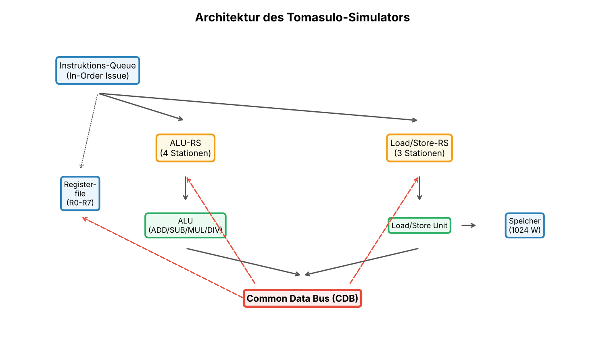
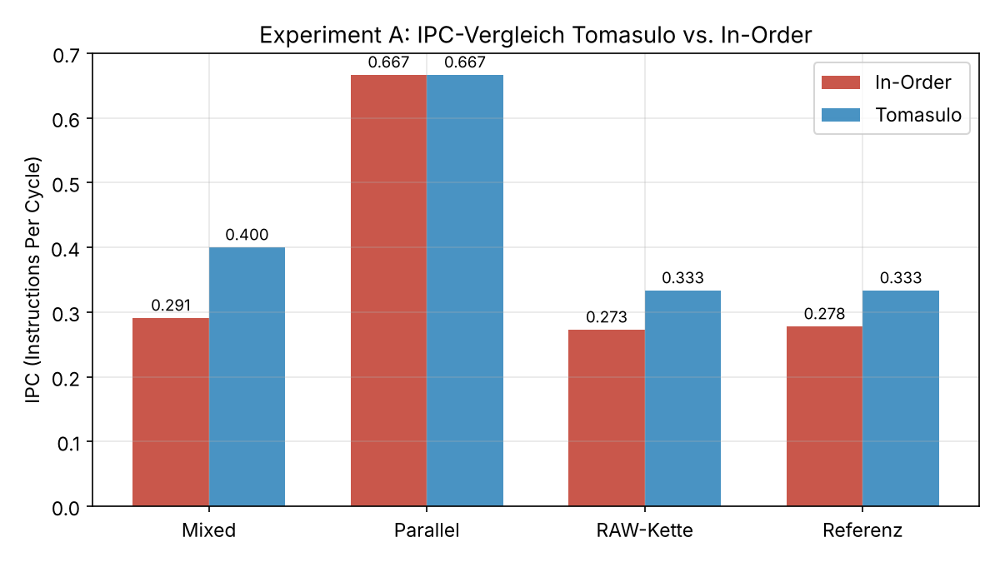

# Tomasulo-Pipeline-Simulator

Ein Simulator für den Tomasulo-Algorithmus, der zeigt, wie ein Prozessor Befehle **out-of-order** ausführt: Instruktionen warten in Reservierungsstationen, bis ihre Operanden bereitstehen, Ergebnisse werden über einen gemeinsamen Datenbus (Common Data Bus) verteilt, und durch implizites Register-Renaming werden WAR- und WAW-Abhängigkeiten aufgelöst.

Entstanden im Rahmen meines Informatikstudiums an der Hochschule Kempten.



## Funktionen

- Simulation einer in-order-issuenden, out-of-order-ausführenden Pipeline Zyklus für Zyklus
- Instruktionen: `ADD`, `SUB`, `MUL`, `DIV`, `LOAD`, `STORE`
- Konfigurierbare Anzahl der Reservierungsstationen und Latenzen der Funktionseinheiten, per Kommandozeile oder JSON-Datei
- Vergleich mit einer einfachen In-Order-Pipeline ohne dynamisches Scheduling
- Ausgabe von Gesamtzyklen, IPC, Stall-Zyklen, aufgelösten RAW-Abhängigkeiten und Auslastung
- Instruktions-Timeline mit Issue-, Execute- und Write-Zyklus jeder Instruktion
- Automatisierte Experimente mit Diagrammen

## Schnellstart

Für den Simulator selbst reicht Python 3.8 oder neuer, externe Bibliotheken sind nicht nötig.

```bash
git clone https://github.com/Ceyhun32/tomasulo-simulator.git
cd tomasulo-simulator

# Einzelnen Trace simulieren
python tomasulo.py traces/referenz.trace

# Mit eigener Konfiguration
python tomasulo.py traces/experiment_mixed.trace --alu-rs 8 --ls-rs 4 --lat-mul 6 --lat-div 10

# Vergleich mit der In-Order-Pipeline, nur Endergebnis
python tomasulo.py traces/experiment_mixed.trace --compare --silent
```

Beispielausgabe für `traces/referenz.trace`:

```
   Nr | Instruktion                    | RS     | Issue |  Exec | Write
  ----------------------------------------------------------------------
    0 | ADD R1, R2, R3                 | ALU0   |     1 |     2 |     3
    1 | MUL R4, R1, R5                 | ALU1   |     2 |     4 |     7
    2 | LOAD R6, 4(R2)                 | LS0    |     3 |     4 |     6
    3 | SUB R7, R6, R4                 | ALU0   |     4 |     8 |     9
    4 | DIV R0, R7, R1                 | ALU2   |     5 |    10 |    15
```

## Kommandozeilenoptionen

| Option | Bedeutung |
|---|---|
| `trace_file` | Pfad zur Trace-Datei |
| `--config`, `-c` | JSON-Datei mit Konfigurationsparametern |
| `--alu-rs` | Anzahl der ALU-Reservierungsstationen |
| `--ls-rs` | Anzahl der Load/Store-Reservierungsstationen |
| `--lat-add` | Latenz von ADD/SUB |
| `--lat-mul` | Latenz von MUL |
| `--lat-div` | Latenz von DIV |
| `--lat-ls` | Latenz von LOAD/STORE |
| `--compare` | zusätzlich mit In-Order-Pipeline vergleichen |
| `--silent` | nur das Endergebnis ausgeben |

Standardkonfiguration: 4 ALU-RS, 3 Load/Store-RS, Latenzen ADD/SUB 1, MUL 3, DIV 5, LOAD/STORE 2 Zyklen, Register R0–R7, Speicher mit 1024 Wörtern.

## Trace-Format

Jede Zeile enthält eine Instruktion oder einen Ausgabebefehl. Kommentare beginnen mit `#`.

```
ADD R1, R2, R3      # R1 = R2 + R3
MUL R4, R1, R5      # R4 = R1 * R5
LOAD R6, 4(R2)      # R6 = Speicher[R2 + 4]
STORE R6, 8(R3)     # Speicher[R3 + 8] = R6
v                   # ausführliche Ausgabe ein/aus
s                   # Zustand der Reservierungsstationen anzeigen
h                   # IPC und Zyklen anzeigen
i                   # Stalls und Abhängigkeiten anzeigen
```

Im Ordner `traces/` liegen fünf Validierungsfälle (`val1` bis `val5`, unter anderem RAW-Ketten, WAR/WAW-Konflikte, strukturelle Stalls sowie Load/Store) und zwei Traces für die Experimente, dazu ein Referenz-Trace (`referenz.trace`).

## Experimente

```bash
pip install -r requirements.txt   # nur für die Diagramme nötig
python run_experiments.py         # Validierung und Experimente A bis D
python generate_charts.py         # erzeugt die Diagramme in charts/
```

| Experiment | Untersuchung |
|---|---|
| A | Tomasulo im Vergleich zur In-Order-Pipeline |
| B | Einfluss der Anzahl der Reservierungsstationen |
| C | Einfluss der Ausführungslatenzen |
| D | Anteil der aufgelösten RAW-Abhängigkeiten |



Bei abhängigkeitsintensiven Traces erreicht Tomasulo einen Speedup von bis zu 1,38 gegenüber der In-Order-Pipeline. Bei vollständig unabhängigen Instruktionen sind beide gleich schnell, weil es keine Hazards gibt, die aufgelöst werden könnten.

Die vollständige Auswertung mit allen Diagrammen steht im [Bericht](docs/Bericht_Tomasulo_Simulator.pdf).

## Projektstruktur

```
tomasulo-simulator/
├── tomasulo.py          # Simulator und Kommandozeilenprogramm
├── run_experiments.py   # Validierung und Experimente A–D
├── generate_charts.py   # Diagramme mit matplotlib
├── traces/              # Validierungs- und Experiment-Traces
├── charts/              # erzeugte Diagramme
└── docs/                # Projektbericht (PDF)
```

## Autor

Ceyhun Akca · [GitHub](https://github.com/Ceyhun32) · [LinkedIn](https://www.linkedin.com/in/ceyhun-akca)
